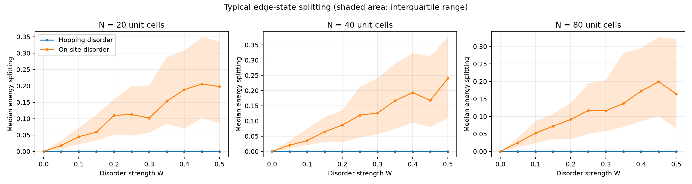
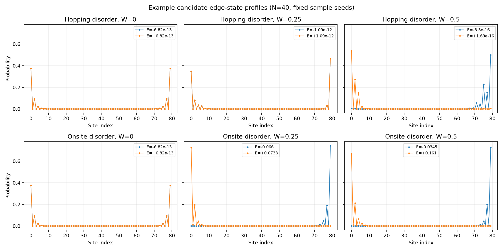

# Topological Edge States in the SSH Model Under Disorder

A reproducible computational study of edge states in the one-dimensional Su–Schrieffer–Heeger (SSH) model. The project compares random hopping disorder, which preserves chiral symmetry in this nearest-neighbor model, with random on-site disorder, which generally breaks it.

The repository contains the simulation code, generated CSV data, plots, a report draft, and a short-presentation outline. Results are specific to the documented finite-chain model and candidate-state rule; read the limitations before interpreting them.

## Model and conventions

Each of the `N` unit cells contains sites `A_n` and `B_n`. The site order in code is `A1, B1, A2, B2, ...`. `t1` is the intracell hopping, and `t2` is the intercell hopping. Open boundaries omit the bond from the last B site back to the first A site.

For a clean infinite chain the bands are

`E±(k) = ±sqrt(t1² + t2² + 2 t1 t2 cos(k))`.

When `t2 > t1 > 0`, the clean chain is in the topological phase for this termination. Its zero-energy edge profile decays by `|t1/t2|` per cell, with localization length `xi = 1 / ln(t2/t1)`. A finite chain has two ends, so their edge modes can hybridize and split slightly in energy.

Hopping disorder samples each bond independently from a uniform interval centered on its clean value: `t1,n = t1 + W eta1,n`, `t2,n = t2 + W eta2,n`, with `eta` uniform on `[-1,1]`. On-site disorder samples `epsilon_i = W eta_i` on every site. Here `W` is a disorder amplitude, not a transition point.

## Setup

Install Python 3, then from the repository root run:

```powershell
python -m venv .venv
.venv\Scripts\Activate.ps1
python -m pip install -r requirements.txt
```

If PowerShell blocks environment activation, invoke `.venv\Scripts\python.exe` directly in the commands below.

## First run: clean chain

```powershell
python src/clean_system.py
```

This prints matrix and symmetry diagnostics and saves `clean_spectrum.png` and `clean_edge_states.png` in `results/figures/`. For the starter values `N=40`, `t1=0.5`, `t2=1.0`, the clean bulk gap is 1 energy unit and the analytical edge localization length is about 1.44 unit cells. The code's printed numerical values must be inspected before calling the implementation validated.

## Disorder ensemble

The default sweep runs `N = 20, 40, 80`, `W = 0, 0.05, ..., 0.50`, and 100 realizations for each disorder model and parameter pair. It uses a fixed base seed (`20261021`) for reproducibility.

```powershell
python -m experiments.disorder_sweep
python -m experiments.plot_results
python -m experiments.plot_example_profiles
```

Outputs are written to `results/data/` and `results/figures/`. The example profile script uses its own documented fixed seed. To try a faster exploratory run, for example:

```powershell
python -m experiments.disorder_sweep --realizations 5 --n-cells 20 40 --w-max 0.2
```

## Results snapshot

The clean `N=40` model passed all seven validation checks. The full default run produced 6,600 realizations. At `N=40`, `W=0.50`, the median candidate-pair splitting was `1.52e-16` for hopping disorder and `0.2403` for on-site disorder. The hopping-disorder mean was larger (`0.0212`) because its distribution includes rare larger values. These are finite-chain observations under the documented candidate-state rule, not a phase boundary or novelty claim; the interpretation and limitations are in the report.





The per-realization CSV preserves the raw observations. The summary CSV reports means, standard deviations, medians, quartiles, sample counts, and standard errors of the mean (SEM). The mean plots use SEM error bars; the additional edge-splitting plot shows the median and interquartile range, which helps reveal skewed realization distributions. `run_metadata.json` records parameters and software versions.

## Observables and interpretation

- **Edge weight:** probability in the first and last four unit cells. It is a spatial diagnostic; the selected states should also be checked in their probability profiles.
- **IPR:** `sum_i |psi_i|^4`. Larger values indicate a more concentrated state, but IPR alone cannot tell an edge-localized state from a bulk-localized one.
- **Edge energies and splitting:** candidate states must lie in the clean central energy window `|E| < |t2-t1|` and have at least 0.5 probability in the predefined edge regions. The two highest edge-weight candidates are reported with energies and separation. If fewer than two qualify, the pair metrics are left missing rather than assigning unrelated states. This is a finite-chain diagnostic, not a topological invariant; strong disorder can still make state identity ambiguous.
- **Bulk-gap estimate:** the gap between the closest negative and positive energies after removing the two selected states. In disorder, spectral asymmetry and localized in-gap states can make this estimate imperfect. Do not equate it with edge-mode splitting or infer a phase transition from it alone.

The default first four unit cells on each side give a fixed spatial window across chain lengths. The energy window uses the clean half-gap and is a tracking convention, not the disordered bulk gap. Review state profiles and consider energy-window and edge-window sensitivity checks before making strong claims.

## Project structure

```text
src/          Hamiltonian, disorder samplers, clean-chain analysis
experiments/  ensemble sweep and plotting scripts
results/data/ generated CSV files (created by a sweep)
results/figures/ generated PNG figures
report/       report template
references/   literature-review notes
```

## Current status and limitations

The clean-chain checks passed, and the full 6,600-realization sweep and plots were generated. The report includes measured results and caveats. The edge-state rule is a finite-chain diagnostic, not a topological invariant; profile, window-size, and energy-window sensitivity should be discussed before treating these results as evidence of topological protection or a phase boundary. See `report/research_report.md`.

## License

This project is distributed under the [MIT License](LICENSE).
